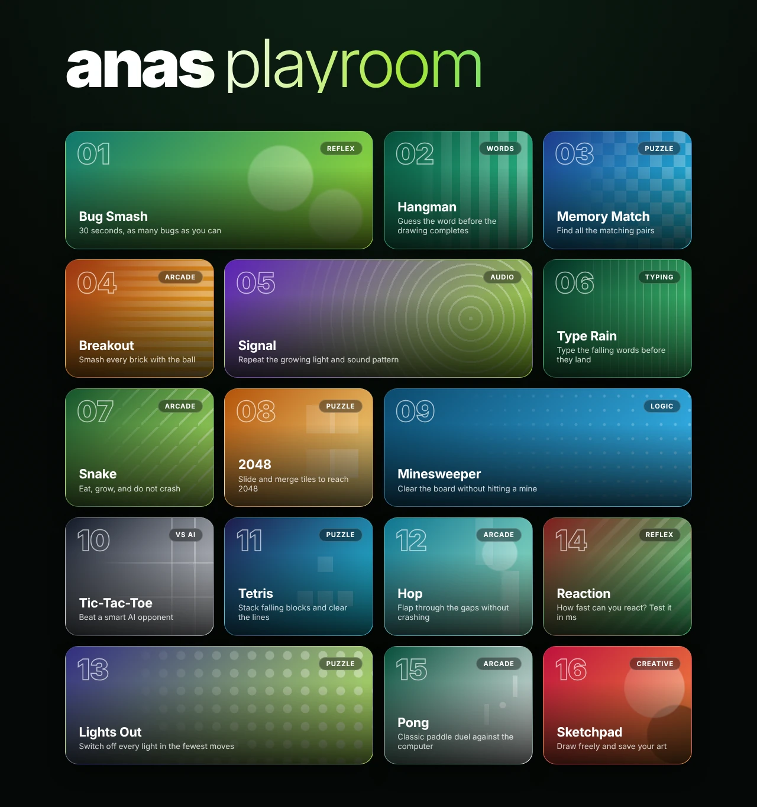
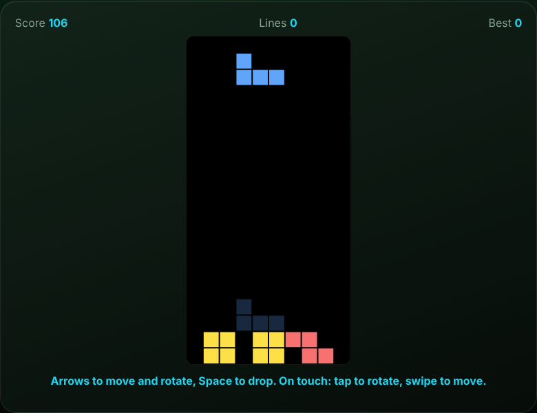
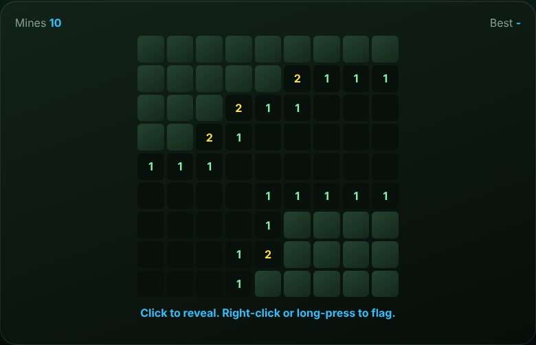
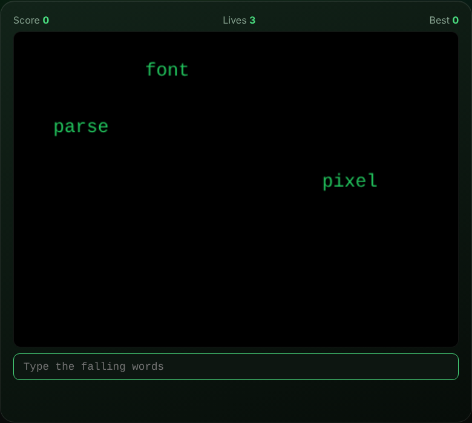

# anas playroom

A browser arcade with **16 handmade games** in one HTML file. No frameworks, no libraries, no build step, no images: every card, pattern and game is drawn with CSS, canvas and plain JavaScript.

  

## Games

| # | Game | Genre | How to play |
|:-:|---|---|---|
| 01 | Bug Smash | Reflex | Click the bugs before they vanish. 30 seconds on the clock. |
| 02 | Hangman | Words | Guess with your keyboard or the on-screen keys. Six mistakes allowed. |
| 03 | Memory Match | Puzzle | Find all 8 pairs in as few moves as you can. |
| 04 | Breakout | Arcade | Mouse, finger or arrow keys. Three lives. |
| 05 | Signal | Audio | Repeat a growing light and sound pattern, generated with the Web Audio API. |
| 06 | Type Rain | Typing | Type the falling words before they land. It speeds up as you score. |
| 07 | Snake | Arcade | Arrows, WASD or swipe. The snake gets faster with every bite. |
| 08 | 2048 | Puzzle | Arrows, WASD or swipe. Merge tiles up to 2048. |
| 09 | Minesweeper | Logic | 9x9 board, 10 mines, first click is always safe. Right-click or long-press to flag. |
| 10 | Tic-Tac-Toe | Vs AI | Minimax opponent that blunders 20% of the time, so you can actually win. |
| 11 | Tetris | Puzzle | Arrows to move and rotate, Space to drop. Ghost piece, line clears and levels. |
| 12 | Hop | Arcade | Click, tap or press Space to flap through the gaps. |
| 13 | Lights Out | Puzzle | 5x5 grid, every puzzle is guaranteed solvable. |
| 14 | Reaction | Reflex | Click the moment the screen turns green and see your time in ms. |
| 15 | Pong | Arcade | First to 7 against a speed-limited AI. Mouse, finger or W/S. |
| 16 | Sketchpad | Creative | Draw with a color palette and brush size, then save as PNG. |

<table>
  <tr>
    <td></td>
    <td></td>
    <td></td>
  </tr>
</table>

## Highlights

- **Zero dependencies.** One `index.html`, about 45 KB, works offline.
- **Works everywhere.** Pointer Events power mouse, touch and pen. Games adapt to phone screens and support swipe controls.
- **Remembers your records.** Best scores and times are stored in `localStorage`, with safe fallbacks when storage is blocked.
- **Clean lifecycle.** Each game returns a cleanup function, so animation frames, timers and key listeners are released when you leave.
- **Polished UX.** Games open in an animated overlay, close with Esc or the Menu button, restore your scroll position, and return keyboard focus to the card you opened.
- **Accessible by default.** Keyboard-playable, labeled controls, visible focus rings, and `prefers-reduced-motion` support.
- **Deep links.** Open a game directly with a hash, for example `index.html#tetris` or `index.html#tic-tac-toe`.

## Browser support

Current versions of Chrome, Edge, Firefox and Safari.
